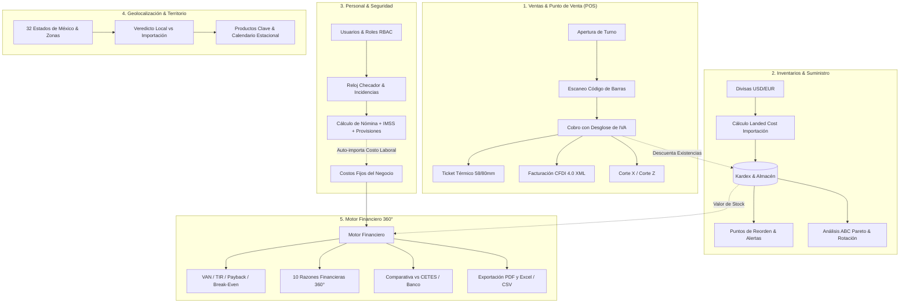

# 📈 EconoMetrics AI - Sistema Integral de Control Operativo, Ventas, Inventarios y Evaluación Financiera 360°

[](https://www.python.org/)
[](https://fastapi.tiangolo.com/)
[](https://sqlite.org/)
[]()

**EconoMetrics AI** es un sistema integral de gestión y evaluación de negocios que cubre el ciclo operativo, comercial y financiero de una empresa: desde el punto de venta (POS) y control de existencias, hasta el análisis de recursos humanos, inteligencia territorial por geolocalización y la evaluación de rentabilidad (VAN, TIR, Payback y 10 Razones Financieras 360°).

---

## 🚀 Arquitectura y Módulos del Sistema

El sistema opera con una arquitectura unificada que conecta en tiempo real los cuatro frentes clave del negocio:



---

## 📋 Módulos Implementados al 100%

### 1. Punto de Venta y Facturación SAT (`/pos.html`)
* **Control de Cajeros y Turnos:** Apertura de caja con fondo inicial, registro de movimientos de efectivo (entradas y salidas), Corte X (arqueo parcial en vivo) y Corte Z (cierre final de turno con cálculo de diferencia).
* **Venta Rápida y Código de Barras:** Lectura con escáner físico de código de barras o búsqueda rápida por SKU / nombre.
* **Desglose Fiscal de IVA:** Manejo de IVA General (16%), IVA Frontera/Alimentos (0%) y Exento.
* **Ticket Térmico Imprimible:** Formato listo para impresión en impresoras térmicas estándar de 58mm y 80mm.
* **Facturación Electrónica CFDI 4.0:** Timbrado y generación de XML conforme al anexo 20 del SAT (ClaveProdServ, ClaveUnidad, régimen fiscal y validación de RFC).

### 2. Inventarios y Catálogo (`/inventario.html`)
* **Catálogo Multimedia:** Carga y previsualización de fotografías de producto en Base64.
* **Precios y Márgenes:** Cálculo automático de Margen Bruto (%) y Markup (%) con advertencia visual de margen negativo.
* **Productos Importados y Divisas:** Módulo de tipos de cambio en vivo (USD/EUR a MXN) y cálculo de **Landed Cost** (costo aduana en divisa × TC + arancel% + fletes internacionales + gastos locales).
* **Puntos de Reorden:** Alertas inteligentes de stock mínimo y sugerencia automática de cantidad a reordenar.
* **Kardex:** Bitácora inmutable de movimientos (entradas, ventas, mermas, ajustes y devoluciones) con costo unitario.
* **Análisis ABC Pareto:** Clasificación 80/20 de inventarios (categorías A, B y C), rotación anual y días promedio de inventario.

### 3. Personal, Roles y Costo Laboral (`/personal.html`)
* **Control de Acceso RBAC:** 5 roles predefinidos (`admin`, `gerente`, `cajero`, `almacenista`, `contador`) con matriz de permisos individuales.
* **Áreas Organizacionales:** Ventas/Caja, Almacén, Finanzas, Recursos Humanos y Administración.
* **Reloj Checador:** Registro de asistencia (Entradas y Salidas) y panel de incidencias (faltas, retardos, incapacidades).
* **Cálculo de Costo Patronal:** Sueldo base + Carga Patronal IMSS/Infonavit (30%) + Provisiones de Ley (Aguinaldo 15 días, Prima vacacional 25%).
* **Conexión Automática a Finanzas:** Botón en la evaluación financiera para importar el costo laboral activo directamente a los Costos Fijos mensuales del proyecto.
* **Bitácora de Auditoría:** Log de auditoría para todas las acciones operativas.

### 4. Inteligencia Territorial y Geolocalización (`/index.html`)
* **Catálogo Territorial Oficial:** Las 32 entidades federativas mexicanas mapeadas con sus hubs logísticos y comerciales (CEDA CDMX, Puerto Interior GTO, Manzanillo, Altamira, Nuevo Laredo, Monterrey, etc.).
* **Elección de Sector y Giro:** Comercio retail, Alimentos y bebidas, Servicios, E-commerce/Tech y Manufactura ligera.
* **Sugerencias de Adquisición Regional:**
  - Veredicto estratégico territorial: **Proveedor Local vs. Importación Directa**.
  - Logística, fletes e infraestructura regional de transporte.
  - Tabla de **productos clave recomendados para la zona** con margen meta (%) y rotación.
  - **Calendario estacional de compras** con oportunidades de negociación por trimestre.

### 5. Motor Financiero 360° y Exportación (`/index.html`)
* **Algoritmos Matemáticos Validados:**
  - **VAN / NPV:** Descontado con la tasa de costo de capital (WACC).
  - **TIR / IRR:** Algoritmo Newton-Raphson con fallback a Bisección.
  - **Payback:** Periodo de recuperación simple y descontado.
  - **Punto de Equilibrio:** Unidades e ingresos mensuales de sobrevivencia y margen de seguridad (%).
  - **Costo de Oportunidad CETES:** Comparativa financiera entre operar el negocio vs. dejar el capital en pagaré bancario/CETES sin riesgo.
* **10 Razones Financieras 360°:**
  1. *Liquidez Corriente* (Meta: 1.5x - 2.5x)
  2. *Prueba Ácida* (Meta: > 1.0x)
  3. *Capital de Trabajo Neto* (Meta: > $0 MXN)
  4. *Margen Bruto* (Meta: > 40%)
  5. *Margen Operativo EBIT* (Meta: 15% - 25%)
  6. *Margen Neto de Utilidad* (Meta: 10% - 20%)
  7. *Rotación de Inventarios* (Meta: 6x - 12x al año)
  8. *ROA - Retorno sobre Activos* (Meta: > 12%)
  9. *ROE - Retorno sobre Capital Propio* (Meta: > 18%)
  10. *Razón de Endeudamiento* (Meta: < 40%)
* **Exportación de Reportes:**
  - **Exportar Dictamen PDF:** Vista ejecutiva formateada con estilos `@media print`.
  - **Exportar Modelo Excel / CSV:** Descarga con formato UTF-8 BOM estructurado en 6 secciones (Identidad, Parámetros, VAN/TIR, Pro-Forma a 5 Años, Ratios 360° y Sensibilidades).

---

## ⚡ Instalación y Ejecución Rápida

### Requisitos
* Python 3.10 o superior.
* Git.

### En Windows
1. Clona el repositorio:
   ```bash
   git clone https://github.com/mixiotes12/econometrics-ai.git
   cd econometrics-ai
   ```
2. Ejecuta el script de inicio (crea el entorno virtual, instala dependencias e inicia el servidor):
   ```powershell
   .\iniciar.bat
   ```
   *O bien ejecuta:*
   ```powershell
   python -m venv .venv
   .\.venv\Scripts\activate
   pip install -r requirements.txt
   uvicorn app.main:app --reload --host 127.0.0.1 --port 8000
   ```
3. Abre tu navegador en `http://127.0.0.1:8000`.

### En Linux / macOS
```bash
bash run.sh
```

---

## 🔑 Credenciales de Acceso por Defecto

* **URL Principal:** `http://127.0.0.1:8000`
* **Usuario:** `Administrador`
* **PIN de Acceso:** `1234`

---

## 🧪 Verificación de Pruebas Automatizadas

El sistema incluye una suite de pruebas end-to-end que valida el 100% de los flujos del sistema:

```powershell
.\.venv\Scripts\python.exe scratch/verify_all_modules.py
.\.venv\Scripts\python.exe scratch/simulate_end_to_end.py
```

**Resultado:**
- 13/13 pruebas unitarias e integrales aprobadas.
- 11/11 etapas de la simulación de ciclo de negocio exitosas.

---

## 📚 Documentación para Evaluadores

Consulta el manual exhaustivo de evaluación con el desglose metodológico y el recorrido paso a paso:
👉 **[Manual de Evaluación y Rúbrica 100%](file:///C:/Users/MIGUEL%20C/.gemini/antigravity/brain/f4c95eac-4f40-4420-94e3-d7e141978c7a/MANUAL_EVALUACION_SISTEMA_INTEGRAL.md)**

---

## 👥 Autores y Licencia
Desarrollado para evaluación académica y profesional bajo licencia MIT.
Repositorio oficial: [mixiotes12/econometrics-ai](https://github.com/mixiotes12/econometrics-ai).
